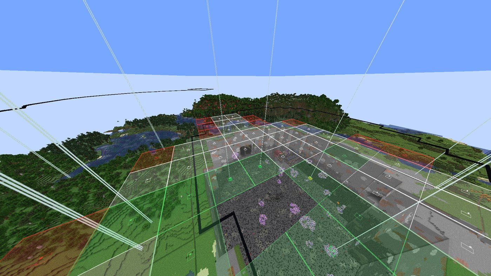
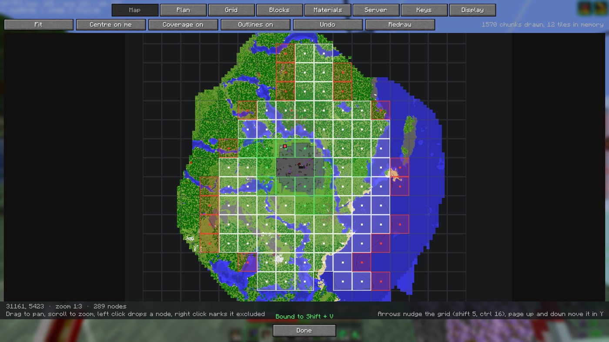

# Beaconator

[](https://github.com/CodeW4VE/Beaconator/actions/workflows/build.yml)
[](LICENSE)
[](https://fabricmc.net/)

Plan and build beacon perimeters: place one beacon, grow the grid, and see exactly where every
other beacon goes and how much ground each one covers.



[Español](README_es.md)

- A map of the area with the whole grid on top. Click nodes to keep, drop or exclude them.
- The real coverage volume of every beacon, so you see the holes before you build.
- A beam over every beacon position: red for missing, yellow for started, green for done.
  Nodes turn green on their own as you build.
- A material list of what the plan needs and what is still missing.
- Optional on the server: put the same jar there and the whole team shares one live plan.

## Installation

- Minecraft 1.21 to 1.21.8, 1.21.11, 26.1.2 and 26.3. One jar per version.
- Fabric Loader 0.16+ (0.19.5+ for 26.3) and [Fabric API](https://modrinth.com/mod/fabric-api).
- Java 21 for 1.21.x, Java 25 for 26.x.

Put the jar in `mods/`. It works on the client alone. Put the same jar on a Fabric server if you
want a shared plan; vanilla clients on that server are never sent anything.

Updating keeps your plans, node states, water lines and totals (they live in
`config/beaconator/` and `config/beaconator.json`).

## Usage

1. Press `Shift + B` to open the screen. `B` turns edit mode on and off.
2. On the **Plan** tab, press **New plan here**, standing near the middle of the area. If the
   perimeter is already half built, press **Detect from world** to read the beacons that are
   there.
3. On the **Map** tab, shape the plan: left click drops a node, right click marks it excluded
   (built, but outside the perimeter).
4. On the **Grid** tab, pick beacons per node, pyramid level, spacing and size. With
   **Spacing follows level** on, coverage lines up with no gaps and no overlap.
5. Go build. `G` hides the beams when they get in the way.



**Team play:** if the server has the mod, a **Server** tab appears. Press **Share mine** and
everyone else opens it by name. Publishing a plan needs operator; marking nodes does not.

Commands: `/bea` (open the screen) and `/bea share` (put the open plan on the server).

<!-- modrinth:end -->

## Details

### Map controls

| Input | What it does |
|-------|--------------|
| Drag | Move the map |
| Scroll | Zoom |
| **Fit** / **Centre on me** | Show the whole plan / jump to where you are |
| Left click a node | Drop it from the plan |
| Right click a node | Mark it excluded |
| Shift + drag (left / right) | Drop / exclude everything in the rectangle |
| Ctrl + drag | Put the rectangle back to pending |
| Ctrl + Z or **Undo** | Undo the last change |
| Arrow keys | Nudge the grid one block (Shift 5, Ctrl 16) |
| Page up / down | Move the grid in Y |
| Alt + drag, or **Move** | Move a single node off the grid |

The map is drawn one pixel per block from chunks you have loaded, and tiles are cached on disk.
The plan saves itself and reopens when you join that server again.

### Moving a single node

Use it when one node lands in a ravine or on something worth keeping. Only that node moves. It
snaps back to its row or column within four blocks (hold Ctrl to place it freely). With **Move**
on, the arrow keys nudge the last node you clicked. A moved node gets a line back to its cell on
the map, and a node moved off its row is left out of the water network.

### Keys

All bindings can be changed in the controls screen or the mod's **Keys** tab, with modifiers
(`G`, `Shift + G` and `Ctrl + Shift + G` are three different bindings).

| Binding | Default |
|---------|---------|
| Edit mode | `B` |
| Open the screen | `Shift + B` |
| Beams on and off | `G` |
| Set the centre where you stand, render on/off, easy place on/off, layer up/down, scan, undo | unbound |

With edit mode on, in the world: scroll grows or shrinks the grid, Shift + scroll changes
beacons per node (1 to 6), Ctrl + scroll nudges the spacing, and left/right click drop or
exclude a node.

### Other features

- 1 to 6 beacons per node on one shared pyramid, so every primary effect can run at once. Layer
  sizes and block counts are worked out for you.
- Excluded nodes get a black stained glass on top so they read as "not ours" from far away.
- Assisted placement picks the right block from your hotbar and blocks plan blocks where the
  plan wants none. A layer filter lets you work one course at a time.
- Litematica import and export. With Litematica installed, easy place follows its toggle.
- English and Spanish, switched from the screen. The screen also opens from Mod Menu.
- Display settings have two pages; the second is **Colours / layers**.
- On 26.x, pressure plates are shown as markers instead of full block models.

### Water lines (for digsorts)

Only useful if you run water from the beacons to a sorter in the middle.

1. Aim at the block where water leaves the sorter, open **Water** and press **Drain: look at it**.
2. Press **Generate**: one channel per row of nodes plus one trunk to the drain, a block clear of
   every pyramid base. Items always travel their shortest path with a single turn.
3. Fix it by hand: **Draw** on, drag to lay a run, right click to erase. What you draw replaces
   the generated part, so **Generate** asks before throwing it away.
4. Check the **Materials** tab: channel, ice, buckets, pressure plates. Ice is counted as what
   you have to mine (9 per packed ice, 81 per blue ice).

Runs through a pyramid base are drawn red and unreachable nodes get a cross; neither is blocked.

Chunk borders: items on bare ice lose their speed when a chunk unloads, so the mod puts a water
source on the last block before every border and never a pressure plate next to one. A corner on
a border gets a red post in the world and a cross on the map. The Cost tab turns green when every
border is under moving water.

With **Sources and plates** on in **Water > Look**, the mod shows where each source and plate
goes. Water already flowing the right way counts as done. Sources and plates are shown and
counted, not placed, and the water network does not export to Litematica yet.

### The geometry

A beacon with `level` layers reaches `10 * level + 10` blocks, so a full level 4 pyramid covers
a 101 block square. That spacing gives exact coverage; anything wider leaves strips with no
effect, which the mod paints red.

Beacons sharing a pyramid turn layer `k` into `(2k + a)` by `(2k + b)`, where `a x b` is the
rectangle the beacons sit in. Four in a row cost 236 blocks per node, four in a square 216.
Beaconator uses the cheapest rectangle. Five and six beacons cost the same (both fit a 2x3).

Coverage is the vanilla effect volume: `2r + 1` wide, `r` down, unbounded upwards. The maths
lives in `xyz.w4ve.beaconator.model`, with no Minecraft code, and is unit tested against a real
208 node perimeter.

## Building

```
JAVA_HOME=/path/to/jdk-21 ./gradlew build
```

The jar lands in `build/libs/`.

## Licence

MIT. Inspired by the schematic and info HUD mods everyone uses; no code was copied from them.
