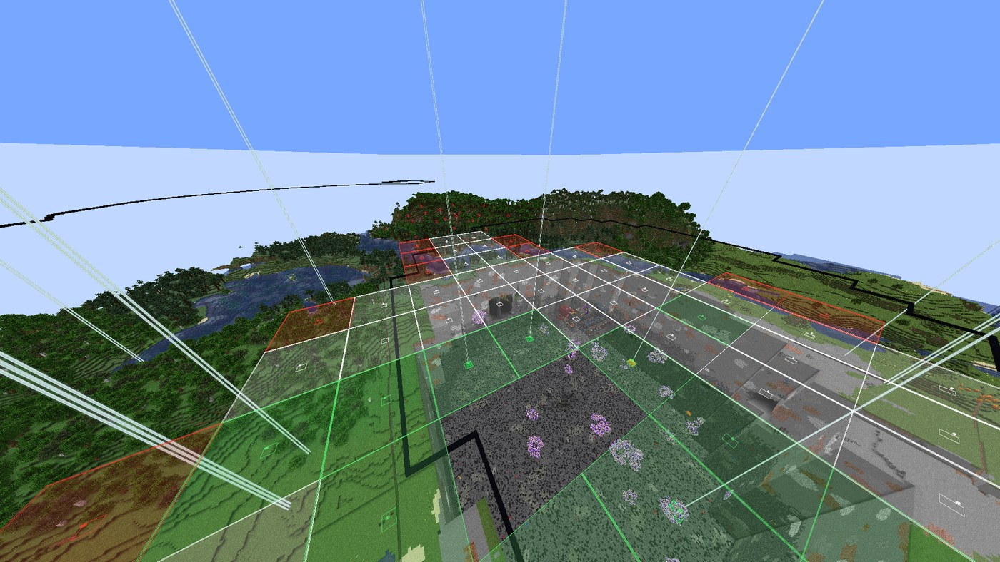
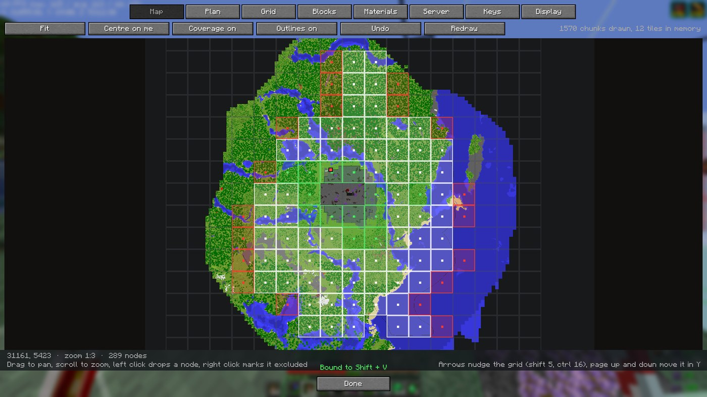

# Beaconator

[](https://github.com/CodeW4VE/Beaconator/actions/workflows/build.yml)
[](LICENSE)
[](https://fabricmc.net/)

Planificá y construí perímetros de beacons: ponés un beacon, agrandás la retícula y ves dónde va
cada uno de los demás y cuánto terreno cubre cada uno.



[English](README.md)

- Un mapa de la zona con toda la retícula encima. Con un clic dejás, quitás o excluís nodos.
- El volumen real que cubre cada beacon, para ver los huecos antes de construir.
- Un haz sobre cada posición: rojo si falta, amarillo si está empezado, verde si está listo. Los
  nodos se ponen verdes solos mientras construís.
- Lista de materiales: lo que pide el plan y lo que todavía falta.
- Opcional en el servidor: con el mismo jar ahí, todo el equipo comparte un plan en vivo.

## Instalación

- Minecraft 1.21 a 1.21.8, 1.21.11, 26.1.2 y 26.3. Un jar por versión.
- Fabric Loader 0.16+ (0.19.5+ para 26.3) y [Fabric API](https://modrinth.com/mod/fabric-api).
- Java 21 para 1.21.x, Java 25 para 26.x.

Poné el jar en `mods/`. Funciona solo en el cliente. Si además lo ponés en un servidor Fabric,
el plan se comparte; a los clientes vanilla de ese servidor nunca se les manda nada.

Al actualizar se conservan los planes, estados de nodos, corrientes y totales (viven en
`config/beaconator/` y `config/beaconator.json`).

## Uso

1. `Shift + B` abre la pantalla. `B` prende y apaga el modo edición.
2. En la pestaña **Plan**, parado cerca del centro de la zona, tocá **Plan nuevo aquí**. Si el
   perímetro ya está a medias, tocá **Detectar del mundo** y el mod lee los beacons que ya hay.
3. En la pestaña **Mapa**, dale forma: clic izquierdo quita un nodo, clic derecho lo marca como
   excluido (construido, pero fuera del perímetro).
4. En la pestaña **Retícula**, elegí beacons por nodo, nivel de pirámide, separación y tamaño.
   Con **Separación según el nivel** prendido, la cobertura encaja sin huecos ni solapes.
5. A construir. `G` esconde los haces cuando estorban.



**En equipo:** si el servidor tiene el mod, aparece una pestaña **Servidor**. Tocá **Compartir el
mío** y los demás lo abren por su nombre. Publicar un plan pide operador; marcar nodos no.

Comandos: `/bea` (abre la pantalla) y `/bea share` (sube el plan abierto al servidor).

## Detalles

### Controles del mapa

| Entrada | Qué hace |
|---------|----------|
| Arrastrar | Mover el mapa |
| Rueda | Zoom |
| **Encajar** / **Centrar en mí** | Ver todo el plan / ir a donde estás |
| Clic izquierdo en un nodo | Quitarlo del plan |
| Clic derecho en un nodo | Marcarlo excluido |
| Shift + arrastrar (izq. / der.) | Quitar / excluir todo el rectángulo |
| Ctrl + arrastrar | Volver el rectángulo a pendiente |
| Ctrl + Z o **Deshacer** | Deshacer el último cambio |
| Flechas | Mover la retícula un bloque (Shift 5, Ctrl 16) |
| Re Pág / Av Pág | Mover la retícula en Y |
| Alt + arrastrar, o **Mover** | Mover un solo nodo fuera de la retícula |

El mapa se dibuja a un píxel por bloque con los chunks que cargaste, y se guarda en disco. El plan
se guarda solo y se vuelve a abrir cuando entrás a ese servidor.

### Mover un solo nodo

Sirve cuando un nodo cae en un barranco o encima de algo que querés conservar. Solo se mueve ese
nodo. Vuelve a su fila o columna si queda a cuatro bloques o menos (con Ctrl lo dejás donde
quieras). Con **Mover** prendido, las flechas mueven el último nodo que tocaste. Un nodo movido
tiene una línea hasta su celda en el mapa, y si sale de su fila queda fuera de la red de agua.

### Teclas

Todas se cambian desde los controles del juego o desde la pestaña **Teclas** del mod, con
modificadores (`G`, `Shift + G` y `Ctrl + Shift + G` son tres teclas distintas).

| Acción | Por defecto |
|--------|-------------|
| Modo edición | `B` |
| Abrir la pantalla | `Shift + B` |
| Haces sí/no | `G` |
| Poner el centro donde estás, dibujo sí/no, colocación asistida sí/no, capa arriba/abajo, escanear, deshacer | sin asignar |

Con el modo edición prendido, en el mundo: la rueda agranda o achica la retícula, Shift + rueda
cambia los beacons por nodo (1 a 6), Ctrl + rueda ajusta la separación, y los clics izquierdo y
derecho quitan o excluyen un nodo.

### Otras funciones

- De 1 a 6 beacons por nodo en una sola pirámide, para tener todos los efectos primarios a la
  vez. Las capas y los bloques se calculan solos.
- Los nodos excluidos llevan un vidrio negro encima, para que se lean como "no es nuestro" de lejos.
- Colocación asistida: elige el bloque correcto de tu barra y no te deja poner bloques del plan
  donde el plan no los quiere. Un filtro de capas deja trabajar una hilada a la vez.
- Importa y exporta Litematica. Con Litematica instalado, la colocación fácil sigue su interruptor.
- Inglés y español, desde la pantalla. La pantalla también abre desde Mod Menu.
- Los ajustes de visualización tienen dos páginas; la segunda es **Colores / capas**.
- En 26.x las placas de presión se muestran como marcas, no como modelos completos.

### Corrientes de agua (para digsorts)

Solo sirve si llevás agua desde los beacons hasta un sorter en el medio.

1. Mirá el bloque por donde el agua sale del sorter, abrí **Agua** y tocá **Desagüe: mirálo**.
2. Tocá **Generar**: una corriente por fila de nodos y un tronco hasta el desagüe, a un bloque de
   cada base de pirámide. Cada ítem hace su camino más corto con una sola curva.
3. Corregí a mano: con **Dibujar** prendido, arrastrá para trazar y clic derecho para borrar. Lo
   que dibujás reemplaza lo generado, por eso **Generar** pregunta antes de tirarlo.
4. Mirá la pestaña **Materiales**: canal, hielo, baldes, placas. El hielo se cuenta como lo que
   hay que picar (9 por hielo compacto, 81 por hielo azul).

Una corriente que atraviesa una base sale en rojo y un nodo al que no llega lleva una cruz; ninguna
de las dos cosas se prohíbe.

Bordes de chunk: sobre hielo solo, los ítems pierden velocidad cuando un chunk se descarga, así que
el mod pone una fuente de agua en el último bloque antes de cada borde y nunca una placa junto a
uno. Una esquina sobre un borde lleva un poste rojo en el mundo y una cruz en el mapa. La pestaña
**Coste** se pone verde cuando todos los bordes tienen agua en movimiento.

Con **Fuentes y placas** prendido en **Agua > Aspecto**, el mod muestra dónde va cada fuente y cada
placa. El agua que ya corre en la dirección correcta cuenta como hecha. Las fuentes y placas se
muestran y se cuentan, no se colocan, y la red de agua todavía no se exporta a Litematica.

### La geometría

Un beacon con `nivel` capas llega a `10 * nivel + 10` bloques, así que una pirámide completa de
nivel 4 cubre un cuadrado de 101 bloques. Con esa separación la cobertura encaja exacta; más ancha
deja franjas sin efecto, que el mod pinta de rojo.

Varios beacons en una pirámide hacen que la capa `k` mida `(2k + a)` por `(2k + b)`, donde `a x b`
es el rectángulo de los beacons. Cuatro en fila cuestan 236 bloques por nodo, cuatro en cuadrado
216. Beaconator usa el rectángulo más barato. Cinco y seis beacons cuestan lo mismo (los dos caben
en un 2x3).

La cobertura es el volumen de efecto vanilla: `2r + 1` de ancho, `r` hacia abajo y sin límite hacia
arriba. La matemática vive en `xyz.w4ve.beaconator.model`, sin código de Minecraft, con tests
contra un perímetro real de 208 nodos.

## Compilar

```
JAVA_HOME=/ruta/a/jdk-21 ./gradlew build
```

El jar queda en `build/libs/`.

## Licencia

MIT. Inspirado en los mods de esquemas y de HUD que usa todo el mundo; no se copió código de ninguno.
